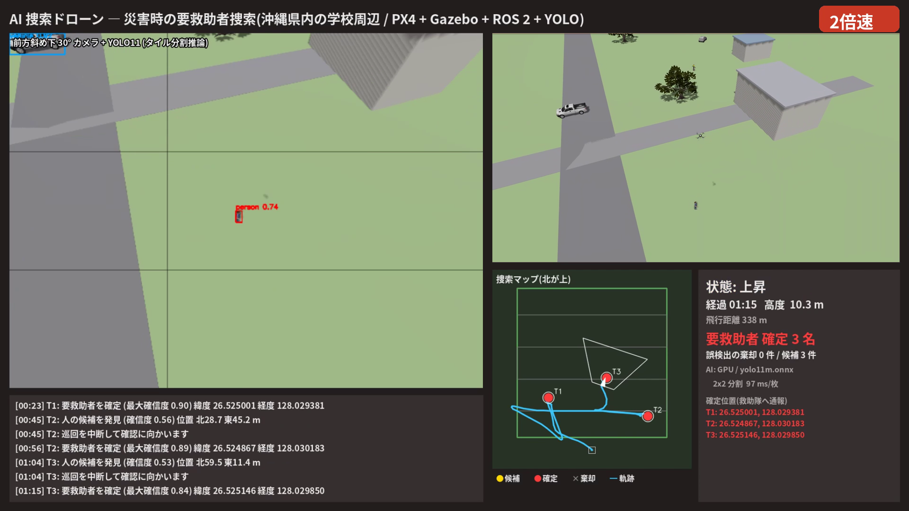
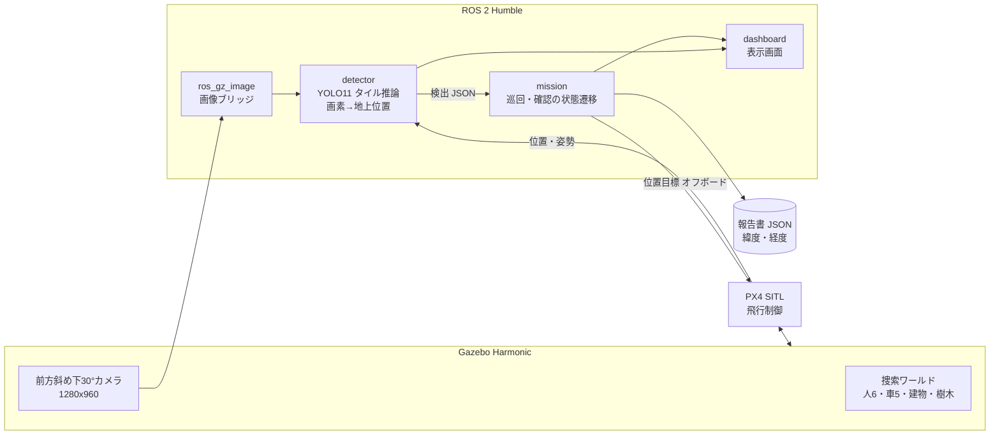

# AI 捜索ドローン ― 災害時の要救助者を AI で見つけて・確かめて・位置を知らせる

Physical AI 応用講座1 最終課題。

災害が起きた直後の沖縄県内の学校周辺(120 m 四方)を想定し、ドローンが自律的に捜索範囲を巡回します。
カメラ映像を AI(YOLO11)で解析し、人を見つけると巡回を中断して近づき、高度を下げて再確認します。
確定した要救助者の位置は、緯度・経度で記録します。

- シミュレータ: PX4 SITL + Gazebo Harmonic
- 制御: ROS 2 Humble(オフボード制御)
- AI: YOLO11m(ONNX Runtime、GPU で推論)



## デモ動画

YouTube: (提出時に URL を記載)。本編は 2 倍速です。

## 結果(斜めカメラ版を 4 回飛行。4 回目がデモ動画)

| | 1回目 | 2回目 | 3回目 | 4回目 |
|---|---|---|---|---|
| 発見した要救助者(正解 6 名) | 6 | 6 | 6 | 6 |
| 誤った確定 | 0 | 0 | 0 | 0 |
| 誤検出として棄却した候補 | 1 | 1 | 0 | 0 |
| 位置誤差 平均 / 最大 [m] | 0.41 / 1.39 | 0.41 / 1.27 | 0.41 / 1.43 | 0.42 / 1.44 |
| 飛行時間 [s] | 246 | 254 | 237 | 240 |


## 仕組み



| 状態 | 内容 |
|---|---|
| 巡回 | 高度 18 m で往復ルートを飛びながら、毎秒 1 回 YOLO で検出(画像を 3x3 に分割) |
| 候補へ移動 | 人の候補(確信度 0.45 以上)が見つかったら巡回を中断し、候補が画像の中央に写る位置へ移動 |
| 降下して再確認 | 高度 10 m まで降り、近い距離から AI で再確認。確信度 0.6 以上で 2 回以上検出すれば「確定」、検出できなければ「誤検出」として棄却 |
| 巡回へ復帰 | 中断した地点に戻って巡回を続ける。全ルートを飛び終えたら帰還して着陸 |

## 工夫した点

1. **タイル分割推論**: 上空から見ると人は十数画素にしか写りません。画像全体を 1 回推論するだけでは 0 人しか検出できなかったため、画像を重なりのあるタイルに分けて推論します(`ai_patrol/yolo_detector.py`)。
2. **カメラを 30° 前へ傾けた**: 真下向きのカメラでは、立っている人は頭と肩しか写らず見逃しが出ました(1回目の飛行は 6 名中 3 名)。人の全身が斜めから写るよう、カメラを 30° 前へ傾けた機体モデル(`gz_models/x500_sar_cam`)を作り、6 名全員を発見できるようにしました。
3. **2 段階確認**: 巡回中に見つけた候補は、近づいて再確認してから確定します。誤検出で救助隊を空振りさせないためです。確定位置は近距離での推定値の平均とし、初期推定の誤差(平均 2.3 m)を 0.4 m まで小さくしています。
4. **姿勢を補正した位置推定**: 画素の視線ベクトルを、機体の姿勢(ロール・ピッチ・ヨー)とカメラの傾きで回転し、地面との交点を求めます。画像を受け取った時点の姿勢を保存しておくので、推論に時間がかかっても位置がずれません(`ai_patrol/geo.py`)。
5. **GPU / CPU の自動切り替え**: CUDA が使えれば YOLO11m を GPU で、使えなければ YOLO11s を CPU で動かします。

各工夫の根拠になった実験は [docs/experiments.md](docs/experiments.md) にあります。

## 動かし方

### 前提

- Ubuntu 22.04、NVIDIA GPU(なくても CPU で動く)
- ROS 2 Humble、Gazebo Harmonic(`ros-humble-ros-gzharmonic`)
- PX4-Autopilot(`~/work/PX4-Autopilot`)、Micro XRCE-DDS Agent
- `px4_msgs` をビルドした ROS 2 ワークスペース(既定は `~/work/map-drone/px4_ws`。`scripts/env.sh` の `PX4_WS` で変更できる)

### 初回のセットアップ

```bash
git clone https://github.com/ba2vwbus13/pai-ai-search-drone.git ~/work/pai_final
cd ~/work/pai_final
./scripts/setup.sh
```

`setup.sh` は次を行います。

- AI 推論用の仮想環境(onnxruntime-gpu)の作成
- YOLO11 の ONNX への書き出し
- Gazebo のモデルの取得
- ワールドと捜索用機体の PX4 への登録
- ROS 2 パッケージのビルド

### 実行(ターミナルを 3 つ使う)

```bash
./scripts/start_sim.sh     # 1. PX4 + Gazebo サーバー
./scripts/start_view.sh    # 2. Gazebo の 3D 画面(ドローンを追従)
./scripts/start_ai.sh      # 3. AI 捜索(自動で離陸 → 捜索 → 帰還 → 着陸)
```

終了したら `results/` に報告書(JSON)が保存されます。評価は次のコマンドで行います。

```bash
python3 tests/evaluate_mission.py results/mission_YYYYMMDD_HHMMSS.json
```

正解データ(`worlds/targets.json`)と照合して、再現率・適合率・位置誤差を表示し、結果の地図を PNG で保存します。

### デモ動画の作成

```bash
./scripts/record_demo.sh video/raw.mp4                       # 録画しながら捜索を実行
./scripts/make_video.sh video/raw.mp4 results/mission_*.json  # 1920x1080・2倍速に編集
```

## ファイル構成

```
ros2_ws/src/ai_patrol/        ROS 2 パッケージ
  ai_patrol/yolo_detector.py    YOLO(ONNX)のタイル分割推論
  ai_patrol/geo.py              画素 → 地上位置、緯度経度の変換
  ai_patrol/detector_node.py    AI 検出ノード
  ai_patrol/mission_node.py     捜索ミッション(状態遷移・PX4 オフボード制御・報告書)
  ai_patrol/dashboard_node.py   表示画面
  config/params.yaml            パラメータ(高度・しきい値・速度など)
  launch/ai_patrol.launch.py
worlds/make_world.py          捜索ワールドと正解データの生成
gz_models/                    捜索用機体(斜めカメラ)、PX4 の機体設定、Gazebo の画面設定
scripts/                      セットアップ・起動・録画・動画編集
tests/                        高度別・カメラ角度別の検出実験、ミッションの評価
docs/                         実験の記録、レポート、図
results/                      飛行結果(真下カメラ版と斜めカメラ版)
```

## ライセンス

このリポジトリのコードは MIT ライセンスです。

使用している外部のソフトウェアとモデルは、それぞれのライセンスに従います。

- YOLO11 の重み: Ultralytics、AGPL-3.0。リポジトリには含めず、`setup.sh` で取得します。
- PX4: BSD-3-Clause
- Gazebo: Apache-2.0
- Gazebo Fuel のモデル: 各モデルのライセンス
