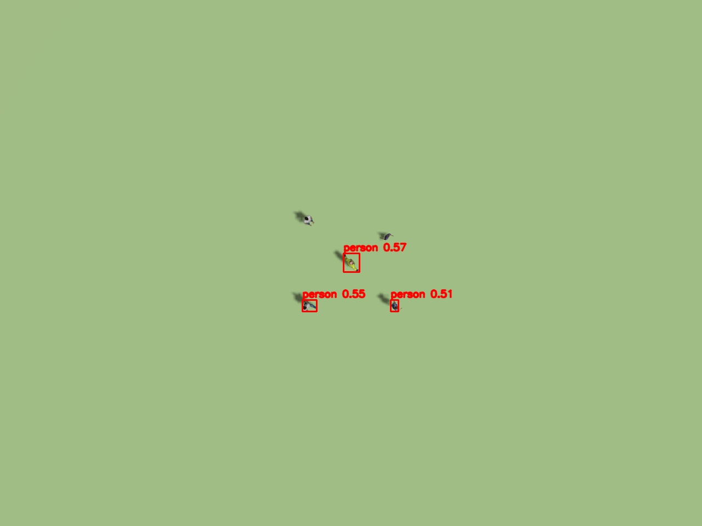
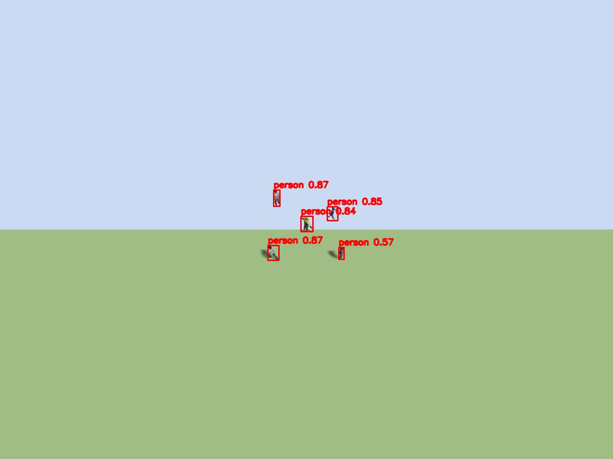
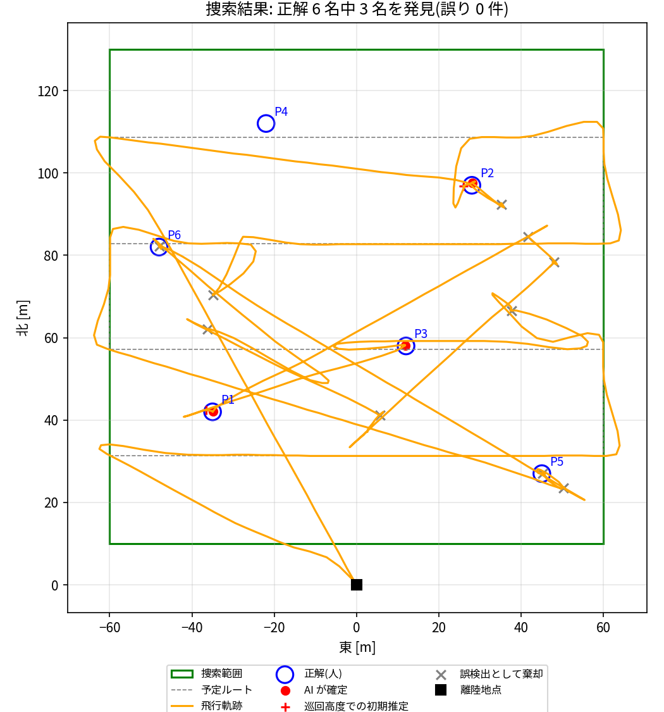
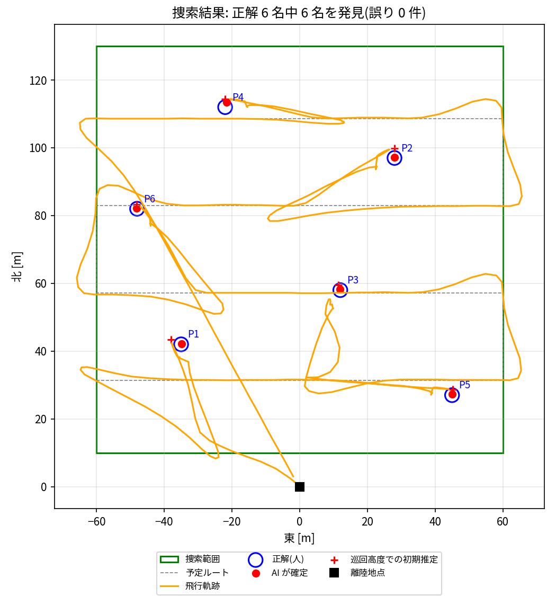

# 実験の記録

設計の各判断(巡回高度、タイル分割、モデル、カメラの角度)は、次の実験で決めました。
実験はすべて Gazebo Harmonic 上で行い、PX4 の `mono_cam`(1280x960、水平画角 1.74 rad)を使っています。

## 実験1: 高度と推論方式による検出性能(真下向きカメラ)

`tests/make_altitude_test_world.py` で、高度 10〜30 m に真下向きのカメラを固定しました。各カメラの真下には、人 3 名(立っている人 2・倒れている人 1)と車 2 台を置いています。

表は、各条件で検出した人数です(正解は 3)。「全体」は画像全体を 1 回で推論する方式、「3x3」は画像を 3x3 のタイルに分けて推論する方式です。

| モデル | 方式 | 10 m | 15 m | 20 m | 25 m | 30 m | 1 枚の時間(CPU) |
|---|---|---|---|---|---|---|---|
| YOLOv8n | 全体 | 0 | 0 | 0 | 0 | 0 | 0.07 s |
| YOLOv8n | 3x3 | 3 | 3 | 3 | 0 | 0 | 0.63 s |
| YOLO11s | 3x3 | 3 | 3 | 3 | 1 | 1 | 1.1 s |
| YOLOv8m | 3x3 | 2 | 3 | 4* | 1 | 0 | 3.3 s |
| YOLO11m | 3x3 | 3 | 3 | 4* | 1 | 3* | 3.0 s(GPU では約 1 s) |

\* 正解より多い数は誤検出を含む。

わかったこと:

- 画像全体を 1 回で推論する方式では、どの高度でも人を検出できない。縮小で人が数画素になるため。**タイル分割は必須**。
- 25 m 以上では検出が不安定になる。そこで巡回高度を **18 m** にした。
- 真上から見た車は、COCO で学習したモデルではほとんど検出できなかった(真上からの車の画像が学習データにほぼ無いため)。捜索の対象は人に絞り、車は参考として表示するだけにした。

GPU(RTX 3060 Laptop、onnxruntime-gpu 1.20)では、YOLO11m の 1 タイルが約 0.1 s です。3x3 の 9 タイルで約 0.2〜1 s になり、毎秒 1 回の検出に間に合います。

## 実験2: カメラの角度による検出性能

`tests/make_tilt_test_world.py` で実験しました。カメラが写す点のまわりに、立っている人 4 名と倒れている人 1 名を置き、カメラの角度を変えて比べました。モデルは YOLO11m、タイルは 3x3 です。

| 高度 | カメラ | 検出した人数(正解 5) | 確信度 |
|---|---|---|---|
| 18 m | 真下 | 3 | 0.57, 0.55, 0.51 |
| 18 m | **前へ 30° 傾ける** | **5** | 0.87, 0.87, 0.85, 0.84, 0.57 |
| 18 m | 前へ 45° 傾ける | 5 | 0.87, 0.83, 0.83, 0.82, 0.66 |
| 12 m | 真下 | 5 | 0.89〜0.68 |
| 12 m | 前へ 35° 傾ける | 5 | 0.90〜0.79 |

| 真下(18 m) | 前へ 30°(18 m) |
|---|---|
|  |  |

わかったこと:

- 真下向きでは、立っている人は頭と肩しか写らず、確信度が 0.5 程度にとどまる。
- 斜めから見ると全身が写り、確信度が 0.8 以上に上がる。
- 45° 傾けると、画像の上端が地平線の近くになる。遠くの点ほど位置推定の誤差が大きくなるため、**30°** を採用した。

## 実験3: 捜索ミッション全体(真下カメラ → 斜めカメラ)

`worlds/okinawa_sar.sdf` の捜索範囲(120 m 四方)には、人 6 名を置いています(倒れている人 2・立っている人 3・歩いている人 1)。ミッション全体を飛行させ、`tests/evaluate_mission.py` で正解と照合しました。

| | 真下カメラ(改善前) | 斜め 30° カメラ(改善後、4 回の平均) |
|---|---|---|
| 発見した要救助者 | 3 / 6(50%) | **6 / 6(100%)** |
| 誤った確定 | 0 | 0 |
| 誤検出の候補を確認しに行った回数 | 10 | 0.5 |
| 位置誤差(確定後)の平均 | 0.31 m | 0.41 m |
| 位置誤差(巡回高度での初期推定)の平均 | 1.42 m | 2.29 m |
| 飛行時間 | 486 s | 244 s |

主なパラメータは次のとおりです。

| 項目 | 真下カメラ | 斜めカメラ |
|---|---|---|
| 候補とする確信度 | 0.30 | 0.45 |
| 確定とする確信度 | 0.50 | 0.60 |
| 確認高度 | 8 m | 10 m |

| 改善前(真下カメラ) | 改善後(斜め 30° カメラ) |
|---|---|
|  |  |

わかったこと:

- 真下カメラで見逃した 3 名(P4・P5・P6)は、いずれも立っている人か歩いている人だった。うち 2 名は候補として見つかっていたが、近距離でも確信度が上がらず棄却された。
- 斜めカメラでは確信度が全体に上がった。そのため候補のしきい値を上げても見逃しが出ず、誤検出の候補への寄り道が減った。その結果、飛行時間がほぼ半分になった。
- 初期推定の誤差は、斜めカメラのほうが大きい(遠くを見ているため)。それでも確認のための降下で 0.4 m 程度まで小さくなる。2 段階確認は、精度の面でも役に立っている。
